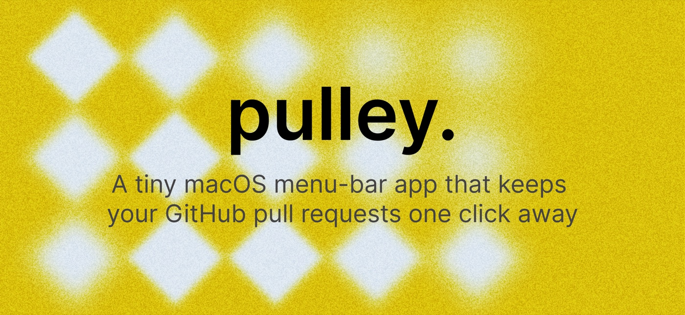
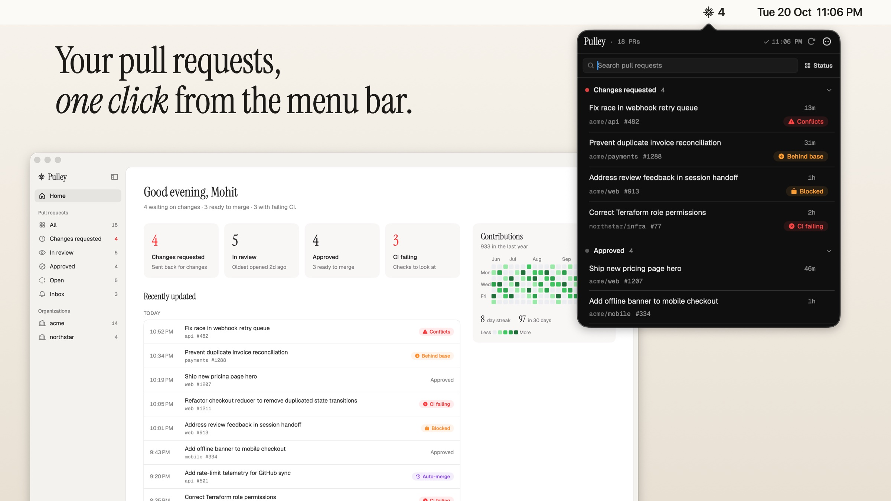
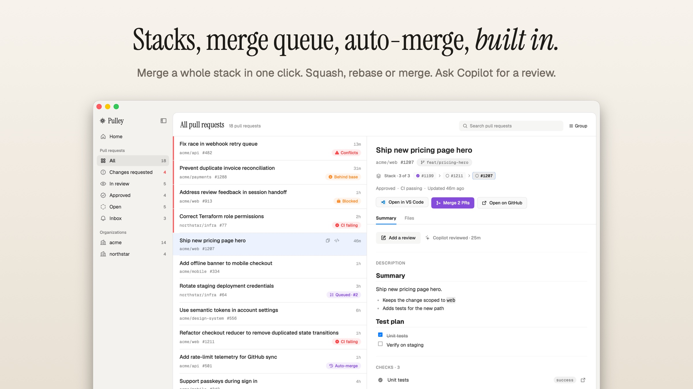

<p align="center">
  
</p>

<h1 align="center">Pulley</h1>

<p align="center">
  Your GitHub pull requests, one click from the Mac menu bar, plus a calm main
  window built around what needs you. Checks each branch out as a git worktree
  so your main checkout stays clean.
</p>

<p align="center">
  <a href="https://github.com/moh-hit/pulley/releases/latest">
    
  </a>
  <a href="https://github.com/moh-hit/pulley/blob/main/LICENSE">
    
  </a>
  
</p>

---

<p align="center">
  
</p>

---

## Features

**In the menu bar**

- **Every PR at a glance** across one or many GitHub orgs: changes requested, CI failing, conflicts, behind base, ready to merge.
- **Tabs for whose PRs**: Authored, Review requests, Assigned and Involved, each with its count. Group by status, repo or org.
- **Up next**: a footer that picks what to do next, like feedback to address, an approved PR to merge, or the review that has waited longest. Click it to open the PR.
- **Act from the menu bar**: approve a teammate's green PR, or nudge reviewers who haven't responded (a comment that mentions them). Rows show PR size and unresolved review threads.
- **Mute repos** you're involved in but don't care about: right-click a PR. Muted repos drop out of lists, counts, notifications and the Inbox.
- **Keyboard-first**: `⌘1`–`⌘4` to switch tabs, `j`/`k` to move, `↩` to open on GitHub, `o` to open in your IDE, `c` to copy the branch. A global hotkey opens it from anywhere.
- **Notifications** for the changes you pick: new PRs, approvals and change requests, CI results, merge conflicts, merge queue and auto-merge.

**In the main window**

- **Home** shows what's waiting on you, what's ready to merge and what's failing, next to your GitHub contribution graph.
- **A sidebar** with your PR filters and live counts, your Inbox, and one entry per organization. It collapses to an icon rail.
- **PR detail** with description, checks and files. Re-run failed checks, add a review, or ask Copilot to review.

**Merging, without the browser**

- Squash, merge commit or rebase (only what the repo allows), with a default you pick.
- **Merge when ready** via auto-merge, and **merge queue** support with live queue position.
- **Stacked PRs**: see where a PR sits in its stack and merge the whole stack in one click.

**Everything else**

- **Open in IDE**: one click checks the branch out as a git worktree beside your clone and opens it in VS Code, Cursor or Zed, so your main checkout stays untouched.
- **Make it yours**: light or dark theme, text size, list density, start page, what the menu-bar count means, and whether drafts show in the menu bar. Changes apply live.
- **Your token stays in the Keychain**, never on disk.

<p align="center">
  
</p>

## Install

### Homebrew (recommended)

```sh
brew install moh-hit/tap/pulley
```

### Download

Grab the latest `Pulley-<version>.dmg` from the [Releases page][releases], open it, and drag `Pulley.app` to `/Applications`.

Releases are signed with a Developer ID and notarized by Apple, so Pulley opens like any other app.

[releases]: https://github.com/moh-hit/pulley/releases

### Build from source

Requires Xcode 15+ / Swift 5.9, macOS 13+.

```sh
git clone https://github.com/moh-hit/pulley.git
cd pulley
./build.sh
open Pulley.app
```

## Configure

On first launch, open the popover and follow the prompt to Settings. Later, open Settings from the gear in the popover, the sidebar in the main window, or `⌘,`.

| Section | What's there |
| --- | --- |
| General | Launch at login, start page, sync interval, what the menu-bar count shows. |
| Appearance | Theme, text size, list density, contribution graph, collapsing bot comments. |
| GitHub | Personal access token (stored in Keychain, with a **Test connection** button) and your organizations. |
| Pull requests | Which PRs to show, default merge method, Copilot review, the IDE to open in, and the workspace folder. |
| Notifications | Turn each kind of notification on or off. |
| Shortcuts | The global hotkey, plus a list of keyboard shortcuts. |

**Workspace folder** is where your clones live. Pulley tries `<folder>/<repo>`, then `<folder>/<org>/<repo>`, and creates worktrees beside the clone.

The token field has an **ⓘ** button with an in-app setup guide and one-click
links to GitHub's token pages (the classic link pre-checks the scopes). For
reference:

- **Classic PAT**: scopes `repo`, `read:org`, and `notifications` (the last
  enables the Inbox). Works for everything.
- **Fine-grained token**: grant access to the orgs' repositories with
  **Pull requests: Read and write**, **Contents: Read and write** (merging, auto-merge, merge queue),
  **Checks: Read and write** (CI details + re-running individual checks),
  **Actions: Read and write** (re-running failed workflow jobs), and
  **Commit statuses: Read** (third-party CI). The Inbox isn't available on
  fine-grained tokens, since GitHub has no notifications permission for them, and
  is skipped gracefully.

## Contributing

Issues and pull requests are welcome. For anything non-trivial, open an issue first.

1. Fork and create a feature branch off `main`.
2. `./build.sh` to verify the bundle launches.
3. Open a PR with a short summary of the change.

## License

[MIT](LICENSE) © Mohit Kumar
